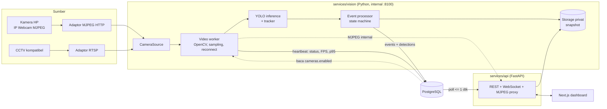
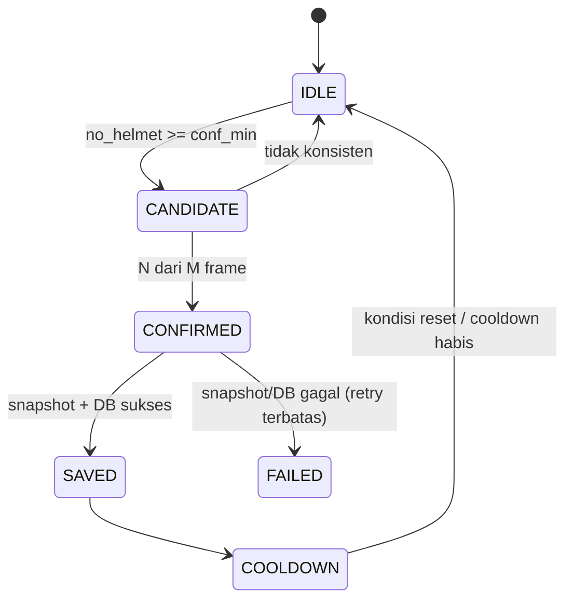

# Architecture & System Design (High-Level)

Dokumen terkait: [PRD](01-PRD.md) · [API & ERD](05-API-SPEC-ERD.md) · [UI/UX](04-UIUX-WIREFRAME.md)

Status: v3 — revisi: integrasi worker↔API via DB, MJPEG di-proxy API, start/stop sebagai flag, decision log, alur end-to-end.

## 1. Prinsip

- **Pisahkan tiga hal:** deteksi AI (model memprediksi), pencatatan kejadian (backend memutuskan kapan cukup konsisten), monitoring (dashboard menampilkan).
- **Modular monolith + layanan AI terpisah:** satu repo, proses Python vision berjalan sendiri.
- **Worker mandiri:** membuka/menutup dashboard tidak memulai atau menghentikan inferensi.
- **Status berasal dari worker**, bukan dari browser.
- **Satu titik integrasi: database.** Worker menulis kejadian dan heartbeat (`worker_status`) ke PostgreSQL; API membacanya (poll ≤ 1 dtk untuk WebSocket). Tidak ada endpoint HTTP internal worker → API.
- **Browser hanya bicara ke API.** MJPEG beranotasi di-proxy API (`/api/stream/{camera_id}`); worker berjalan di jaringan internal (port 8100, tidak dipublish ke host).
- **Tanpa Redis/Kafka/Kubernetes** di versi pertama.

## 2. Diagram logis



Dashboard menerima metadata lewat REST dan WebSocket; video memakai MJPEG yang di-proxy API. Frame tidak pernah dikirim lewat WebSocket, dan browser tidak pernah mengakses worker secara langsung.

## 3. Komponen

| Komponen | Teknologi | Tanggung jawab |
|---|---|---|
| Web | Next.js, TypeScript, Tailwind | Monitoring, log, detail, review |
| API | FastAPI, Pydantic, SQLAlchemy, Alembic | REST, validasi, auth, akses metadata, WebSocket, proxy MJPEG |
| Video worker | Python, OpenCV/FFmpeg | Baca stream, ambil frame terbaru, reconnect, heartbeat status ke DB |
| Inference | Ultralytics YOLO | Deteksi + tracking |
| Event processor | Python | Validasi temporal, dedup, snapshot, tulis DB |
| DB | PostgreSQL | Kamera, kejadian, deteksi, review, `worker_status` |
| Storage | Filesystem privat (object storage nanti) | Snapshot asli dan beranotasi |
| Deploy | Docker Compose | Konfigurasi konsisten; GPU opsional |

## 4. Abstraksi sumber video

```python
class CameraSource:
    def connect(self): ...
    def read_frame(self): ...   # frame terbaru
    def reconnect(self): ...
    def close(self): ...
```

Implementasi pertama: `PhoneStreamSource` membaca MJPEG HTTP dari IP Webcam (`http://<ip>:8080/video`) — sudah diuji di minggu 1. `RtspSource` disiapkan sebagai stub untuk CCTV. Worker hanya bergantung pada antarmuka ini, sehingga pindah ke CCTV hanya mengganti adaptor dan konfigurasi.

Syarat teknis: koneksi FFMPEG wajib menyetel `rw_timeout` (via `OPENCV_FFMPEG_CAPTURE_OPTIONS`) agar `read_frame()` tidak menggantung saat Wi-Fi putus; reconnect berjalan dengan backoff.

## 5. Pemrosesan frame

1. Baca frame **setiap iterasi** loop (menguras buffer MJPEG — murah); inferensi dijalankan terjadwal setiap `1/TARGET_FPS` detik sehingga frame yang diproses selalu yang terbaru.
2. Sesuaikan resolusi.
3. Inferensi YOLO → kelas, bbox, confidence.
4. Tracker menghubungkan deteksi antar-frame.
5. Frame beranotasi (bbox tergambar) di-encode JPEG sebagai frame terbaru untuk MJPEG.
6. Evaluasi aturan pencatatan kejadian.

## 6. Event processor (state machine per track)



Hipotesis awal eksperimen: `conf_min = 0.5`, konsistensi **3 dari 5** frame. Nilai final ditentukan dari eksperimen, bukan ditebak. Tracker tidak menjamin ID konstan saat occlusion; cooldown tidak boleh hanya bergantung pada `track_id`.

Fallback MVP anti-duplikat: pencatatan ditahan bila bbox kandidat ber-IoU > 0,3 dengan bbox event terakhir pada kamera yang sama dalam `COOLDOWN_SECONDS`. Naik ke zone-based bila duplikat masih > 5%.

**Aturan konsistensi data:** jangan buat record berstatus lengkap bila snapshot wajib gagal ditulis. Catat status gagal eksplisit dan retry terbatas.

## 7. Snapshot dan waktu

- `original.jpg` (frame asli, tidak dimodifikasi) dan `annotated.jpg`.
- Urutan penulisan: file dulu → baru INSERT `events`. Gagal file → `snapshot_status=failed` + retry ≤ 3; gagal DB total → log + `worker_status.error_message`, tidak pernah ditandai sukses.
- Path: `storage/snapshots/YYYY/MM/DD/<event-id>/`. DB hanya menyimpan path/object key.
- Tidak di folder publik Next.js; akses via `GET /api/events/{id}/snapshot` dengan otorisasi.
- Timestamp dicatat saat kejadian terkonfirmasi; simpan UTC, tampilkan WIB.

## 8. Penanganan kegagalan

| Kegagalan | Perilaku |
|---|---|
| Kamera/Wi-Fi terputus | Status `reconnecting` lalu `offline`, reconnect dengan backoff, `last_seen_at` tidak diperbarui |
| Model gagal dimuat | Worker state `error` + pesan di `worker_status`; health menampilkan AI bermasalah, API tetap hidup |
| Inferensi error | Frame dilewati, error di-log, worker tidak crash |
| DB tidak dapat diakses | Kejadian tidak ditandai sukses, retry terbatas |
| Snapshot gagal | Status gagal eksplisit, retry terbatas |
| WebSocket putus | Dashboard menampilkan banner, reconnect otomatis, riwayat dari REST |
| Worker mati | API tetap hidup; stream → 503 rapi; status basi terlihat dari `last_heartbeat_at` |

## 9. Risiko dan mitigasi

| Risiko | Mitigasi |
|---|---|
| Helm terlihat tapi tidak dipakai | Definisi kelas dan anotasi konsisten; hubungan helm-kepala; pertimbangkan kelas `person`/`motorcycle` |
| Stream HP tidak cocok | Uji metode streaming di minggu 1 (lulus: IP Webcam MJPEG) |
| Kamera terlalu jauh/miring | Tetapkan area pantau, ukur kualitas di jarak target |
| Model terlalu lambat | Turunkan resolusi/frekuensi, model lebih ringan, export OpenVINO |
| Log duplikat | Tracking, konsistensi temporal, cooldown + fallback IoU |
| Snapshot gagal | Validasi tulis, logging, retry terbatas |
| OCR plat tidak akurat | Opsional, diukur terpisah |
| Storage penuh | Retensi, batas kapasitas, penghapusan terjadwal |
| Akses gambar tidak aman | Auth, otorisasi, storage privat, proxy API |
| Wi-Fi kampus memblokir HP ↔ server (client isolation) | Demo/uji memakai hotspot HP; verifikasi `curl` ke stream sebelum demo |
| Anotasi dataset makan waktu | Tools anotasi (Roboflow/CVAT) + auto-label bootstrap; model interim dari subset boleh lebih awal |
| Klaim terlalu optimistis | Test set terpisah, lapor metrik aktual |

## 10. Keamanan dan roles

- Kredensial RTSP/MJPEG hanya di konfigurasi rahasia server (`.env`/secret), tidak pernah ke browser; DB menyimpan `stream_config_ref` + `location` (lokasi boleh ke browser, URL jangan).
- Roles: `admin` vs `operator`. Auth wajib untuk start/stop kamera (admin), ubah konfigurasi (admin), registrasi kamera (admin), review (operator+admin), dan snapshot (operator+admin).
- Frontend: sembunyikan menu `/cameras` untuk operator + guard route (redirect ke `/monitoring`); backend tetap enforce 403. `/cameras` diakses via dropdown user, bukan nav header.
- Worker berjalan hanya di jaringan internal Docker; portnya tidak dipublish ke host.
- Token JWT untuk endpoint gambar (stream/snapshot) boleh lewat query `?token=` karena `` tidak bisa menyetel header; trade-off diterima untuk demo lokal (token dapat tercatat di log akses).
- CORS dibatasi ke origin dashboard; secret tidak masuk Git.

## 11. Strategi ML (ringkas)

- Kelas inti: `helmet`, `no_helmet` (tambah `person`/`motorcycle` hanya bila ada tujuan jelas).
- Split train/val/test **berdasarkan video/sumber**, bukan acak per frame.
- Dataset direkam dengan HP, orientasi/ketinggian/resolusi **sama dengan deployment**.
- Training dilakukan di Google Colab; inference deployment di CPU (`yolo11n`, `imgsz=640`; turunkan imgsz atau export OpenVINO bila FPS kurang).
- Model interim dari subset dataset boleh dipakai untuk integrasi pipeline; retrain dengan dataset lengkap sebelum evaluasi final.
- Alur: baseline tanpa fine-tuning → evaluasi error → anotasi kasus gagal → fine-tune → bandingkan pada test set sama.
- Contoh perintah awal (sesuaikan hardware/versi):

```bash
yolo detect train model=yolo11n.pt data=dataset.yaml epochs=100 imgsz=640 batch=16 patience=20
```

## 12. Deployment dan multi-kamera

Satu server di jaringan lokal via Docker Compose: `web` (port 3000), `api` (port 8000), `db`, + N `vision` worker (pola 1 kamera = 1 worker/proses; port internal 8100, hanya API yang mengaksesnya). Kamera HP via IP Webcam MJPEG; HP dapat berperan sebagai hotspot (IP AP Android umumnya `192.168.43.1`).

Menambah kamera (ringkas — detail di README):

1. Tambah `CAM0N_STREAM` di `.env` → `docker compose up -d`.
2. Daftarkan kamera di `/cameras` (admin): nama, lokasi, tipe, `stream_config_ref`.
3. Tambah service `vision-camN` di `docker-compose.yml` (duplikat blok `vision`, ganti `CAMERA_ID`) → `docker compose up -d`.

Jika salah satu langkah belum lengkap, status kamera menunjukkan `error` dengan pesan jelas — bukan gagal diam-diam. Start/Stop adalah pause/resume pemrosesan (flag `cameras.enabled`), bukan manajemen proses.

Untuk 2 HP: jalankan `vision-cam1` dan `vision-cam2`, masing-masing baca 1 stream, tulis status sendiri ke DB. Jangan baca 2 stream dalam 1 loop sekuensial (yang lag menghambat yang lain).

UI memakai pola single-focus: `/monitoring?camera=<id>` menampilkan 1 feed besar (2/3 layar) + panel info lokasi/status/FPS (1/3 layar). Tidak ada grid multi-feed di MVP. Jangan menjanjikan realtime sebelum mengukur di perangkat target. Catat versi model dan dataset yang dipakai evaluasi.

## 13. Decision log (final)

| # | Keputusan | Alasan | Alternatif yang ditolak |
|---|---|---|---|
| 1 | Stack tetap Next.js + FastAPI + PostgreSQL | Frontend sudah jadi dan sesuai docs; tidak ada syarat stack dari dosen; risiko proyek ada di model, bukan di web framework | Pindah ke Django + FastAPI (tumpang tindih dua framework); full Django (rewrite UI, 1–2 minggu) |
| 2 | Integrasi worker ↔ API via DB (heartbeat + poll ≤ 1 dtk) | Satu titik integrasi; tanpa internal token/endpoint; error handling antar-service hilang | Worker POST status ke API internal |
| 3 | MJPEG di-proxy API (`/api/stream/{camera_id}`), worker internal-only | Satu origin untuk browser; auth & CORS sekali; worker tanpa port publik; aman bila dashboard kelak di HTTPS | Browser langsung ke worker (port publik per kamera, auth ganda) |
| 4 | Start/stop = flag `cameras.enabled` yang dipoll worker ≤ 5 dtk | API tidak menyentuh proses/Docker socket (keamanan) | Manajemen proses/docker dari API |
| 5 | WS tanpa `detection.live` | Anotasi bbox sudah menyatu di MJPEG; menghindari metadata per frame | Push metadata bbox per frame |
| 6 | `plate_reads`/OCR ditunda dari migrasi awal | Prioritas P2; tabel dibuat saat fitur dikerjakan | Ikat OCR ke MVP |
| 7 | 1 kamera = 1 worker proses (dipertahankan) | Isolasi kegagalan; pola scale sederhana; sesuai CI/compose | Vision multi-thread satu proses |
| 8 | Inference CPU; training di Colab | Hardware yang tersedia; GPU opsional nanti | Menyediakan GPU untuk inference |
| 9 | Tema UI terang (mengikuti kode aktual) | UI sudah jadi; docs diselaraskan | Balik ke tema gelap |
| 10 | Dokumentasi didahulukan (spec v3 sebelum kode) | Tracking perubahan; aturan PR di CONTRIBUTING | Kode dulu, docs menyusul |

Tanggal keputusan: 2026-10-17.

## 14. Alur end-to-end

Satu kejadian, dari deteksi sampai review — perhatikan bahwa snapshot **bukan** dipicu oleh user yang membuka dashboard; worker berjalan mandiri.

**0. Sebelum ada user.** Worker CAM-01 hidup: baca baris kamera dari DB → resolve `CAM01_STREAM` dari env → buka stream HP → loop frame + inferensi + heartbeat (`worker_status`, `cameras.status=online`). Kejadian bisa tercatat walau tidak ada yang membuka dashboard.

**1. Login.** `POST /api/auth/login` → JWT (berisi role) → frontend simpan token → redirect `/monitoring`. Guard role: operator tidak bisa membuka `/cameras` (UI + API 403).

**2. Monitoring.** `GET /api/cameras` → selector + badge status + FPS/p95 (dari `worker_status`). Live feed = MJPEG `GET /api/stream/{id}?token=` (proxy). WS `/ws` menyiarkan `camera.status` (poll DB ≤ 1 dtk) dan `event.created`.

**3. Deteksi (worker, paralel dengan langkah 2).** `no_helmet >= conf_min` → CANDIDATE → konsisten N dari M → CONFIRMED → tulis `original.jpg` + `annotated.jpg` → INSERT `events` + `detections` → COOLDOWN. Gagal file → `snapshot_status=failed` + retry; tidak pernah "sukses palsu".

**4. Log.** INSERT terdeteksi API ≤ 1 dtk → WS `event.created` (toast). `/logs` menampilkan tabel dengan filter kamera/tanggal/status + pagination; waktu dikonversi WIB di UI.

**5. Detail & review.** `/logs/[id]` → snapshot asli/beranotasi (endpoint terotorisasi) → operator+admin memberi verdict confirmed/false_positive + catatan → `event_reviews` + update `review_status`. Prediksi model tidak diubah; review adalah lapisan manusia yang juga menjadi bahan evaluasi.

**6. Dashboard ditutup.** Worker tetap berjalan; snapshot dan status tetap tercatat. Riwayat diambil dari REST saat dashboard dibuka kembali.
