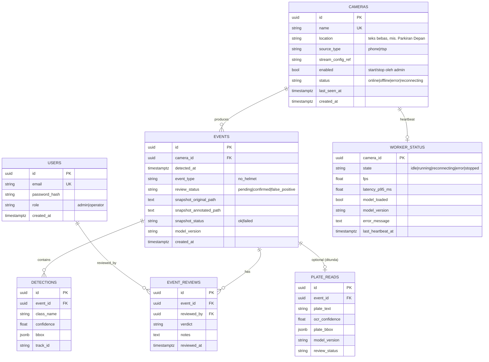

# API Specs & ERD (Technical Specs)

Dokumen terkait: [Architecture](03-ARCHITECTURE.md) · [PRD](01-PRD.md)

Base URL: `/api` · Format: JSON · Waktu: ISO 8601 UTC · Auth: Bearer token (JWT) kecuali `/api/health`. Token juga diterima via query `?token=` untuk endpoint gambar (stream/snapshot) karena `` tidak dapat menyetel header.

## 1. ERD



`USERS` ditambahkan karena kebutuhan autentikasi dan `reviewed_by`. `WORKER_STATUS` ditulis worker tiap heartbeat (± 2 dtk) — API membacanya untuk `/health` dan siaran WebSocket. `plate_reads` hanya dibuat bila fitur OCR aktif dan **ditunda dari migrasi awal MVP**; tidak adanya tabel/record bukan kegagalan deteksi helm.

## 2. Skema tabel

### `cameras`
| Kolom | Tipe | Catatan |
|---|---|---|
| id | UUID PK | |
| name | VARCHAR UNIQUE | mis. CAM-01 |
| location | VARCHAR/TEXT | Teks bebas lokasi pasang, mis. "Parkiran Depan". Boleh null saat migrasi, wajib di form baru. Tampil di monitoring + logs |
| source_type | VARCHAR | `phone`, `rtsp` |
| stream_config_ref | VARCHAR | Referensi ke secret server, **bukan** URL |
| enabled | BOOLEAN | Default `true`. Start/stop admin = set flag; worker menerapkan ≤ 5 dtk |
| status | VARCHAR | `online`, `offline`, `error`, `reconnecting` (ditulis oleh worker) |
| last_seen_at | TIMESTAMPTZ | Frame terakhir diterima |
| created_at | TIMESTAMPTZ | |

### `worker_status`
| Kolom | Tipe | Catatan |
|---|---|---|
| camera_id | UUID PK/FK | 1:1 dengan `cameras` |
| state | VARCHAR | `idle`, `running`, `reconnecting`, `error`, `stopped` |
| fps | REAL | Diukur worker (EMA) |
| latency_p95_ms | REAL | Dari ring buffer inferensi terakhir |
| model_loaded | BOOLEAN | |
| model_version | VARCHAR | |
| error_message | TEXT | Pesan terakhir saat `state=error` |
| last_heartbeat_at | TIMESTAMPTZ | Indikator worker hidup; status basi terlihat dari sini |

### `events`
| Kolom | Tipe | Catatan |
|---|---|---|
| id | UUID PK | |
| camera_id | UUID FK | Index |
| detected_at | TIMESTAMPTZ | Index; saat terkonfirmasi |
| event_type | VARCHAR | `no_helmet` |
| review_status | VARCHAR | `pending`, `confirmed`, `false_positive`; index |
| snapshot_original_path | TEXT | Path/object key |
| snapshot_annotated_path | TEXT | |
| snapshot_status | VARCHAR | `ok` atau `failed` |
| model_version | VARCHAR | |
| created_at | TIMESTAMPTZ | |

Index: `(detected_at DESC)`, `(camera_id)`, `(review_status)`, gabungan `(camera_id, detected_at DESC)`.

### `detections`, `event_reviews`, `plate_reads`
Lihat ERD. `bbox` berformat `{"x1":..,"y1":..,"x2":..,"y2":..}` dalam piksel frame asli (disimpan sebagai JSON; naik ke JSONB bila diperlukan index/operasi jsonb).

## 3. Endpoint REST

| Method | Endpoint | Fungsi | Role |
|---|---|---|---|
| POST | `/api/auth/login` | Login, kembalikan token + role | publik |
| GET | `/api/auth/me` | Info pengguna (termasuk role) | operator, admin |
| GET | `/api/cameras` | Daftar kamera (location, status, fps/latency dari `worker_status`) | operator, admin |
| GET | `/api/cameras/{id}` | Detail + status + location | operator, admin |
| POST | `/api/cameras` | Registrasi kamera (name, location, source_type, stream_config_ref) | admin |
| POST | `/api/cameras/{id}/start` | Mulai pemrosesan kamera (set `enabled=true`; worker menerapkan ≤ 5 dtk) | admin |
| POST | `/api/cameras/{id}/stop` | Hentikan pemrosesan (set `enabled=false`) | admin |
| GET | `/api/events` | Log (filter camera_id, status, tanggal + pagination) | operator, admin |
| GET | `/api/events/{id}` | Detail kejadian (termasuk camera.location) | operator, admin |
| GET | `/api/events/{id}/snapshot?type=original\|annotated` | Gambar bukti | operator, admin (terotorisasi) |
| GET | `/api/stream/{camera_id}?token=` | MJPEG beranotasi (proxy ke worker; 503 bila worker mati) | operator, admin |
| PATCH | `/api/events/{id}/review` | Simpan hasil review | operator, admin |
| GET | `/api/health` | Status backend + dependensi + workers[] (dari `worker_status`) | publik |

### `POST /api/auth/login`
Request: `{"email": "admin@example.com", "password": "..."}`
Response: `{"access_token": "...", "token_type": "bearer", "role": "admin", "email": "admin@example.com", "expires_in": 3600}`

### `GET /api/events`
Query: `page` (1), `page_size` (20, maks 100), `camera_id`, `status`, `date_from`, `date_to` (ISO UTC), `sort` (`-detected_at` default).

```json
{
  "items": [
    {
      "event_id": "3f9a...",
      "camera_id": "a1b2...",
      "camera_name": "CAM-01",
      "camera_location": "Parkiran Depan",
      "detected_at": "2026-10-16T09:20:31Z",
      "event_type": "no_helmet",
      "confidence": 0.91,
      "review_status": "pending",
      "snapshot_available": true
    }
  ],
  "page": 1, "page_size": 20, "total": 134
}
```

Nilai confidence di atas hanya contoh format; backend mengisinya dari inferensi nyata.

### `GET /api/events/{id}`
```json
{
  "event_id": "3f9a...",
  "camera": {"id": "a1b2...", "name": "CAM-01"},
  "detected_at": "2026-10-16T09:20:31Z",
  "event_type": "no_helmet",
  "model_version": "helmet-v1.2",
  "snapshot_status": "ok",
  "review_status": "pending",
  "detections": [
    {"class_name": "no_helmet", "confidence": 0.91,
     "bbox": {"x1": 410, "y1": 120, "x2": 520, "y2": 260}, "track_id": "12"}
  ],
  "reviews": []
}
```

### `PATCH /api/events/{id}/review`
Request: `{"verdict": "confirmed" | "false_positive", "notes": "opsional"}`
Efek: membuat baris `event_reviews`, memperbarui `events.review_status`. Prediksi asli tidak diubah.

### `POST /api/cameras`
Request: `{"name": "CAM-01", "location": "Parkiran Depan", "source_type": "phone", "stream_config_ref": "CAM01_STREAM"}`
`stream_config_ref` merujuk variabel/secret di server, bukan URL. `location` teks bebas, tampil di monitoring + logs.

### `GET /api/health`
```json
{
  "status": "degraded",
  "api": "ok",
  "database": "ok",
  "storage": "ok",
  "workers": [{"camera_id": "a1b2...", "state": "running", "fps": 12.4, "latency_p95_ms": 310}],
  "model": {"loaded": true, "version": "helmet-v1.2"}
}
```

## 4. WebSocket

Endpoint: `/ws` (token via query/subprotocol). Hanya metadata; **bukan** frame video.

| Tipe pesan | Payload |
|---|---|
| `camera.status` | `{camera_id, status, last_seen_at, fps, latency_ms}` |
| `event.created` | Sama dengan item `/api/events` |
| `worker.error` | `{camera_id, code, message}` |

API mem-poll database tiap ≤ 1 dtk dan menyiarkan perubahan; latensi siaran ≤ 1 dtk. Anotasi bbox **tidak** dikirim via WebSocket — sudah tergambar di MJPEG.

Klien harus reconnect otomatis dan mengambil ulang riwayat dari REST setelah tersambung kembali.

## 5. Streaming video

Frame beranotasi dikirim lewat `GET /api/stream/{camera_id}?token=...` (MJPEG). API mem-proxy dari worker di jaringan internal (`http://vision:8100`, port tidak dipublish) sehingga browser hanya berkomunikasi dengan API — satu origin, auth sekali di API. Bila worker mati → `503`. WebRTC hanya dipertimbangkan bila latensi MJPEG terbukti tidak memadai.

## 6. Format error

```json
{"error": {"code": "EVENT_NOT_FOUND", "message": "Kejadian tidak ditemukan", "details": null}}
```

| HTTP | Kode umum |
|---|---|
| 400/422 | `VALIDATION_ERROR` |
| 401 | `UNAUTHENTICATED` |
| 403 | `FORBIDDEN` |
| 404 | `EVENT_NOT_FOUND`, `CAMERA_NOT_FOUND`, `SNAPSHOT_NOT_FOUND` |
| 409 | `WORKER_ALREADY_RUNNING` |
| 503 | `DEPENDENCY_UNAVAILABLE`, `WORKER_OFFLINE` |

## 7. Aturan penting

- Kredensial kamera tidak pernah muncul di respons (hanya `stream_config_ref` + `location` boleh ke browser).
- Worker tidak menerima request dari browser/luar jaringan internal; semua akses lewat API.
- `start`/`stop` adalah flag `cameras.enabled`, bukan manajemen proses; worker menerapkan ≤ 5 dtk.
- Token via query hanya untuk endpoint gambar (stream/snapshot).
- Snapshot hanya lewat endpoint terotorisasi (operator+admin).
- UI `/cameras` admin-only, tapi API tetap enforce 403 untuk operator.
- Pagination wajib pada `/api/events`. Filter `camera_id` wajib didukung untuk selector di `/monitoring` dan filter di `/logs`.
- Migrasi skema lewat Alembic; jangan ubah tabel manual. Tambahan `location` via 1 migrasi.
